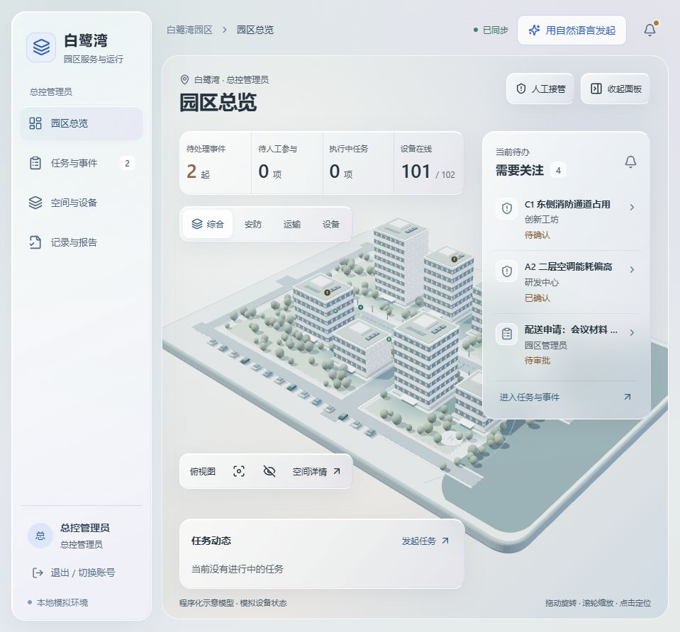

# 白鹭湾 AI 园区中枢 · 三维玻璃 UI

**版本：v1.1 / revision：`deepseek-glass`**

本地可运行的全栈园区演示：React + Three.js 前端、Node.js 业务后端、SQLite 数据库与独立设备模拟器。本次采用团队提供的三维玻璃 UI，以三维首页、银灰磨砂面板和左侧分区导航组织任务、空间设备、配送与事件记录；自然语言任务理解接入 DeepSeek。

园区模型、地图、设备、遥测、路线和任务执行均为模拟。DeepSeek 模式会访问真实模型 API，API Key 仅由后端读取。模型理解结果还需经过后端业务校验，不能直接控制设备。

本次修改、配置及验证边界见 [DeepSeek 与玻璃 UI 修改说明](docs/DEEPSEEK-GLASS-v1.1.md)。历史设计说明保留供追溯，本次配置以该说明和 `.env.example` 为准。

## 本次交付与下一步

已验证的完整项目位于：

```text
C:\Users\不羡Rin、\Documents\Codex\2026-10-31\agent-1-2-3-4-5-19\outputs\bailuwan-deepseek-glass
```

**长期维护目录尚未更新。** 自动写入 `C:\auto work\bailuwan-ai-hub-v1.1` 时创建备份目录被系统拒绝（`EPERM`），旧服务和数据库未改动。请在上面的交付目录双击 **`APPLY-TO-V1.1.cmd`**：它会校验目标、停止旧服务并确认端口离线，备份源码/配置/数据，复制本次代码和前端构建产物，设置后端 DeepSeek 文件凭据并启动检查。原数据库保留，备份位于目标目录 `backups/before-deepseek-glass-*`。

更新器成功后打开 **http://127.0.0.1:8788/**（保留原 `.env` 的端口配置），核对 `/api/health` 的 `revision=deepseek-glass`。如更新器报错，请保留窗口信息并检查 `.runtime` 日志。

本次隔离预览使用 **http://127.0.0.1:8791/**，数据库是 `data/glass-preview.sqlite`；其 `.env` 用于验收，不要覆盖长期目录配置。预览已完成真实 DeepSeek 配送闭环。用户会话中双击后台启动器才能避免聊天工具回收进程的影响。



## 安装与启动

需要 **Node.js 24 或更新版本**。使用 Node 自带 `node:sqlite`，无需额外安装数据库。

```powershell
npm install
Copy-Item .env.example .env
```

已有 `.env` 时请直接编辑，保留端口和数据库路径，不要重复覆盖。

编辑项目根目录 `.env`，配置后再构建启动：

```dotenv
HOST=127.0.0.1
PORT=8788
DB_PATH=./data/park-v1.1.sqlite
API_BASE=http://127.0.0.1:8788
AI_MODE=model
AI_PROVIDER=deepseek
DEEPSEEK_BASE_URL=https://api.deepseek.com
DEEPSEEK_MODEL=deepseek-flash
DEEPSEEK_TIMEOUT_MS=30000
DEEPSEEK_API_KEY_FILE="C:/本地私有目录/deepseek API key.TXT"
SESSION_COOKIE_NAME=blw_session_v11
```

`DEEPSEEK_API_KEY_FILE` 改为电脑上已授权的 Key 文件完整路径。也支持后端环境变量 `DEEPSEEK_API_KEY`；不要把真实 Key 写入前端、文档或版本库。`AI_MODE=rules` 是明确的规则模拟模式，不会访问模型；模型模式失败时不会静默切换规则并执行。

```powershell
npm run build
npm start
```

访问配置的本机地址，默认 **http://127.0.0.1:8788/**。`npm start` 同时启动后端和独立模拟器，首次启动创建数据库，之后保留记录。

Windows 上可双击 `START-BACKGROUND.cmd`，由用户会话在隐藏后台启动，关闭浏览器后继续运行；双击 `STOP.cmd` 停止。日志位于 `.runtime/server.log` 和 `.runtime/server-error.log`。这不是开机服务，电脑重启后需再次启动。修改 `.env` 或后端代码后需停止再启动。请勿使用旧 `PREVIEW.cmd` 验证 DeepSeek：该评审启动器固定使用规则模拟。

开发与检查：

```powershell
npm run dev
npm test
npm run build
npm run db:init
```

开发前端默认 http://127.0.0.1:5174/ 。`db:init` 补建结构与缺失的初始化数据，不清空已有业务记录。测试使用隔离数据库。仅首页返回 HTTP 200 不代表模型或业务链路已验证。

## 演示账号

本机演示账号共用密码 **`Bailuwan2026!`**，人工接管需超级管理员身份再次输入该账号密码。

| 账号 | 角色 | 主要权限 |
| --- | --- | --- |
| `admin` | 超级管理员 | 园区调度、人工接管和恢复 |
| `park` | 园区管理员 | 园区运营与任务调度 |
| `ops` | 运维人员 | 设备控制、授权配送调度 |
| `security` | 安保人员 | 告警、巡检、到岗核验 |
| `approver` | 审批人员 | OA 审核与执行反馈 |
| `viewer` | 普通用户 | 本人服务申请与授权范围内查看 |

角色权限由后端校验。普通用户不能直接获得运营调度权限；已有服务申请和审批数据继续保留。

## 推荐演示流程

1. 用 `admin` 登录，查看三维首页。旋转、缩放、聚焦建筑，切换图层并点击建筑或设备查看详情。
2. 进入任务输入，明确选择“物品配送”，输入“从科创中心配送 2 公斤资料到研发中心”。DeepSeek 理解起终点、重量与目标；后端校验当前位置、载重、路线冲突、电量和返航余量，自动选择可行资源并派单，写入园区日志，**无需 OA 审批**。未给重量或地点时会要求补充。
3. 若从通用文本入口输入配送目标，先查看识别方案，再点击一次确认派单；这次确认不是 OA 审批。普通用户申请仍遵循其角色服务权限。
4. 查看配送路线、位置和任务进度，模拟到达后确认交接并归档。低电量、离线、路线阻塞或资源占用会按规则拒绝、等待或进入人工处理，不会伪造成功。
5. 选择设备发出控制指令，等待独立模拟器回执。巡检事件依次确认、派单、处理、复核和归档；消防演练的高风险联动仍需授权人员明确确认。
6. 人工接管前查看影响，完成身份确认后暂停自动化和 Agent 调用；解除时执行状态检查，任务由人工决定是否继续。

## 代码与数据位置

```text
frontend/src/          React 界面、角色导航、Three.js 场景
backend/server.mjs    HTTP API、登录、权限、实时事件
backend/llm.mjs       DeepSeek / 兼容模型适配与输出校验
backend/hub.mjs       中枢任务编排
backend/routing.mjs   本地路线、位置、电量和资源选择
backend/service.mjs   设备、配送、告警、接管等业务规则
backend/store.mjs     SQLite 存储与审计
backend/simulator.mjs 独立设备模拟服务
data/park-v1.1.sqlite 默认业务数据库，实际位置由 DB_PATH 决定
scripts/              启停和演示脚本
tests/                隔离的业务与模型适配测试
dist/                 npm run build 生成的前端产物
.env                  本机配置，不应提交或打包真实密钥
.runtime/             运行日志和进程记录，不是源码
docs/                 修改、API、Agent 与设备扩展文档
```

## 后端维护与更新

1. 使用本项目 `STOP.cmd` 停止对应进程，确认配置端口不再提供旧服务。
2. 备份源码、`.env` 和整个 `data/` 目录；数据库存在 `-wal`、`-shm` 文件时一并备份。运行中的 SQLite 不应只随意复制主文件作为一致性备份。
3. 更新源码和 `dist/`，保留原数据库及本机凭据配置；安装依赖、执行测试与构建。
4. 使用 `START-BACKGROUND.cmd` 重启，核对 `/api/health` 的版本、revision 与模拟器状态，再登录验证任务和设备回执。模型仅“已配置”不代表已成功调用，需检查模型验证状态及实际任务结果。

本次工作副本与用户长期维护目录是独立位置。当前长期目录更新被 `EPERM` 拒绝；请运行交付目录的 `APPLY-TO-V1.1.cmd`。它执行上述停止、备份、保留数据库、复制、配置及启动检查步骤。完成后仍需在该目录服务核对 revision，不能用工作副本成功代替目标目录验收。

## 本次验证

- 完整测试 **55/55 通过**，生产前端构建通过。
- 真实 DeepSeek 任务理解用时 **1.249 秒**，共 **817 tokens**，正确识别 `B01 → B02`、2 公斤和收件岗位。
- 隔离预览中的真实模型任务 `HUB-595A37A1` 直接选择“云翼配送无人机”，规划 76 米模拟路线，预计到达电量 84.7%，无 OA 审批。模拟器推进至 100%，管理员填写模拟交接后任务完成。
- 预览健康接口显示 `revision=deepseek-glass`、DeepSeek 已配置并完成成功调用验证、模拟器已连接；浏览器检查与首页截图已完成。

以上业务验证发生在 8791 隔离预览，长期目录尚待用户运行更新器。

## 模型故障定位

| 错误 | 含义 | 处理 |
| --- | --- | --- |
| `MODEL_AUTH_ERROR` | 上游 401/403，凭据或访问权限问题 | 检查后端 Key 文件、账户和可用模型 |
| `MODEL_INSUFFICIENT_BALANCE` | 上游 402，模型账户余额不足 | 在 DeepSeek 对应 API 账户检查余额 |
| `MODEL_RATE_LIMITED` | 上游 429，请求频率或并发限制 | 降低并发，按重试时间稍后提交 |
| `MODEL_OVERLOADED` | 上游 503，模型服务暂时过载 | 稍后重试 |
| `MODEL_LOCAL_RATE_LIMIT` / `MODEL_BUSY` | 园区后端自身的频率或并发保护 | 等待提示时间，避免重复点击 |
| `MODEL_TIMEOUT` / `MODEL_INVALID_OUTPUT` | 超时或输出不合约定 | 本次不创建执行任务，核对后重试 |

后端错误仅返回清理后的信息，不显示供应商原始响应或 Key。429 不等于余额耗尽。

## 交付边界

这是单机可操作演示系统。DeepSeek 的自然语言理解是真实 API 功能；三维模型、设备控制回执、视频信息、配送路线及移动均是模拟。消防、无人机和工业安全的生产接入需要独立验证。SQLite、会话和本地模拟器适用于演示；后续可接入本地兼容模型、真实 GIS/建筑模型、设备适配器、企业 SSO 和 PostgreSQL。

现有审计日志采用哈希链与数据库触发器限制常规修改；不构成对宿主机所有者的不可篡改保证。生产部署需独立审计存储和备份恢复。
