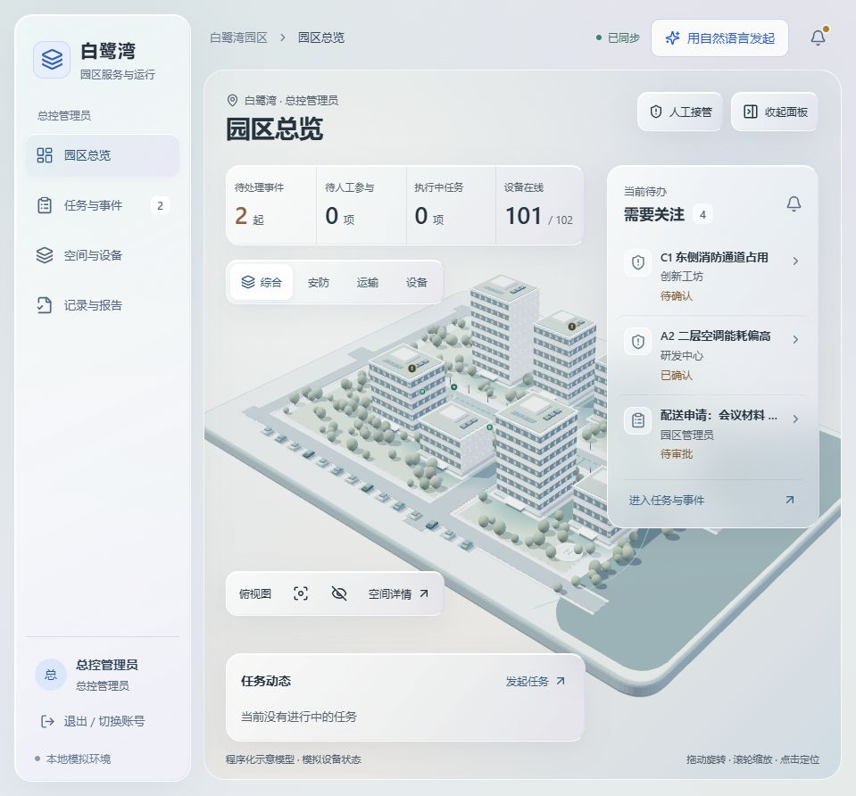

# v1.1 三维玻璃 UI 与 DeepSeek 接入修改说明

日期：2026-11-01。版本保持 **v1.1（1.1.0）**，本次修订标识为 **`deepseek-glass`**。

## 1. 修改依据与范围

采用团队提供的 `白鹭湾AI园区_三维玻璃UI新版_20261031/bailuwan-ai-hub` 作为界面基础。它包含完整前后端代码，本次整合以其中三维首页、银灰磨砂玻璃面板、左侧分区导航和角色工作台为准，继续连接业务后端及数据库。

首页以园区三维场景为中心，浮层集中展示运行指标、告警与任务；建筑、设备、图层和视角控制保持可操作。日常管理围绕任务、空间设备、配送与事件组织；审批和考勤按角色进入相应工作台，不作为总控主入口。已有记录保留，不因界面收敛删除数据库数据。

## 2. DeepSeek 模型接入

后端 `backend/llm.mjs` 增加 DeepSeek 供应商适配，通过官方 Chat Completions 接口调用 **`deepseek-flash`**，使用 JSON 输出模式并关闭思考模式。任务结构、类型、资源 ID、字段和缺失条件由本地严格校验。

发送模型的上下文限于当前目标、显式条件、时间及必要建筑目录；路线、电量、设备选择和权限判断留在后端。模型不能扩大权限或绕过人工接管。模型失败不会静默转为规则成功或直接派单。

```dotenv
AI_MODE=model
AI_PROVIDER=deepseek
DEEPSEEK_BASE_URL=https://api.deepseek.com
DEEPSEEK_MODEL=deepseek-flash
DEEPSEEK_TIMEOUT_MS=30000
DEEPSEEK_API_KEY_FILE="C:/本地私有目录/deepseek API key.TXT"
```

Key 文件路径由本机设置，不在文档写入密钥。后端也支持 `DEEPSEEK_API_KEY`；前端和交付归档不得包含真实 Key。更改配置后需重启服务。既有 OpenAI 兼容适配保留作为扩展接口，本次正式演示配置选择 DeepSeek。

## 3. 自动配送流程

- 超级管理员、园区管理员与运维明确选择配送类型后，模型识别语义，后端校验并直接派单，**不创建 OA 审批**。
- 通用文本入口识别配送时先生成可核对方案，用户确认一次后派单；这次操作是任务确认。
- 普通用户仍遵循其角色服务申请权限，不能因模型输出获得调度权限。
- 起点、终点和重量等关键条件不足时请求补充，不猜测重量或位置。
- 后端按资源当前实际模拟位置计算接近取件点的可行路线，核对在线状态、任务占用、载重、通道冲突、预计耗电及 **20% 电量安全余量**，从可行候选中选择最近资源。
- 执行进度由独立模拟器回传；派单、路线、选择依据、模型调用与任务结果写入园区日志及关联任务。到达后进行交接、签收和归档。

模型负责自然语言判断；当前路网和耗电为模拟规则，路线计算采用可复查的本地算法。这里的“智能规划”不表示模型自行输出坐标即可驱动现实设备。

## 4. 错误提示调整

| 来源 | 错误码 | 用户含义 |
| --- | --- | --- |
| DeepSeek 402 | `MODEL_INSUFFICIENT_BALANCE` | API 账户余额不足 |
| DeepSeek 429 | `MODEL_RATE_LIMITED` | 请求频率或并发达到限制，按提示等待 |
| DeepSeek 503 | `MODEL_OVERLOADED` | 上游服务暂时过载 |
| DeepSeek 401/403 | `MODEL_AUTH_ERROR` | Key 或模型访问权限异常 |
| 本应用请求保护 | `MODEL_LOCAL_RATE_LIMIT` / `MODEL_BUSY` | 园区中枢请求过于频繁或并发已满，非供应商余额判断 |
| 超时、无效或截断输出 | 对应模型错误码 | 未完成任务理解，不创建自动执行任务 |

上游错误仅暴露清理后的状态和可用重试时间，不透传原始供应商消息。HTTP 429 与余额不足分开解释，避免“仍有额度却被提示额度受限”的混淆。

## 5. 权限与人工确认

保留六类角色、后端权限校验、请求幂等、模型调用期间的接管状态复核以及审计链。人工接管仍需超级管理员身份确认。消防及其他高风险联动继续人工确认，自动配送的审批简化不改变这些风险边界。

## 6. 启动、数据库与更新

安装、演示账号及完整目录见 [README](../README.md)。常规顺序为 `npm install`、配置 `.env`、`npm run build`、`npm start`。长期本机演示可由用户双击 `START-BACKGROUND.cmd`；停止用 `STOP.cmd`。旧 `PREVIEW.cmd` 固定使用规则模式，不能用于确认 DeepSeek 接入。

默认数据库 `data/park-v1.1.sqlite`，可通过 `DB_PATH` 修改。更新前停止对应服务，备份源码、`.env` 和整个数据目录，保留现有 SQLite 文件；不得通过删除数据库“修复”升级。需要新增结构时由初始化逻辑补建，保留历史记录。重启后检查 `/api/health` 的 `version` 与 `revision`，再检查模拟器回执和实际任务。

本次整合与验证在以下隔离项目完成：

```text
C:\Users\不羡Rin、\Documents\Codex\2026-10-31\agent-1-2-3-4-5-19\outputs\bailuwan-deepseek-glass
```

预览地址 `http://127.0.0.1:8791/`，使用独立数据库 `data/glass-preview.sqlite`。常规部署默认端口 8788，数据库 `data/park-v1.1.sqlite`；已有用户配置应保留。

**长期目录尚未更新。** 尝试自动更新 `C:\auto work\bailuwan-ai-hub-v1.1` 时，创建备份目录返回 `EPERM`；即使请求到权限，实际文件系统仍拒绝写入。操作在停止旧服务和复制文件之前结束，旧服务与数据未改动。

下一步由用户在交付项目根目录双击 **`APPLY-TO-V1.1.cmd`**。更新器固定校验该 v1.1 目标，备份目录可创建后才停止旧服务，确认端口离线，再备份源码/配置/整个数据目录、复制明确清单内的源码与 `dist/`、设置后端 DeepSeek 配置、启动并检查 revision/模型配置/模拟器连接。它保留现有数据库、已有端口及数据库路径，不复制预览数据库和运行状态。API Key 保持在原文件，通过后端本地路径引用。

成功后访问 `http://127.0.0.1:8788/`（已有配置为其他端口时使用原端口），查看 `/api/health` 的 `revision=deepseek-glass`。启动检查不代替首次实际模型任务检查；需要执行一条目标明确的配送并查看日志。备份位于目标目录 `backups/before-deepseek-glass-*`，异常时先停服务再按备份恢复，保留升级后的数据供排查。

## 7. 验证记录与边界

- 已使用提供的 Key 请求官方 `/models`，返回 HTTP 200；目录包含 `deepseek-flash` 与 `deepseek-v4-pro`，因此本次选择 `deepseek-flash`。这证明凭据可访问模型目录，不单独等同于任务推理成功。
- 新增 DeepSeek 适配测试 3 项已通过：支持字段和 JSON 协议、402/429/503/认证错误区分，以及截断/无效输出/未知资源/密钥回显拒绝。
- 本次完整回归 **55/55 项通过**（既有 52 项及新增 3 项），生产前端构建通过。
- 已真实调用 `deepseek-flash` 完成任务理解：用时 **1.249 秒**、共 **817 tokens**，正确提取 `from=B01`、`to=B02`、重量 2 公斤及收件岗位。
- 已在浏览器通过 8791 隔离预览提交真实 DeepSeek 任务 **`HUB-595A37A1`**：后端直接选择 **云翼配送无人机**，76 米模拟路线，预计到达电量 **84.7%**，未创建 OA 审批；独立模拟器推进至 100%，管理员填写模拟交接后任务状态变为 `completed`。
- 预览健康接口确认 `revision=deepseek-glass`、`provider=deepseek`、模型已配置且成功调用后为 `ready/verified`、模拟器 `connected`。浏览器三维首页检查已完成，截图见 [glass-home.png](glass-home.png)。
- 长期维护目录的自动更新因 `EPERM` 未执行完成，旧服务与数据未动；需用户运行上节更新器后，在目标地址另行核验。预览通过不代表该目录已部署。



## 8. 已完成、模拟与假设

**本次实现**：采用提供的三维玻璃 UI 代码基础；接入服务端 DeepSeek 任务理解；兼容模型适配、本地校验、角色调度、自动配送、日志和人工接管边界继续保留；修正模型服务错误分类。

**模拟部分**：白鹭湾建筑造型、路网、园区位置、设备遥测、机器人/无人机运动、能耗、告警证据与设备执行回执。程序化模型不代表真实测绘成果，演练不等于现实消防调度。

**假设条件**：单机演示、Node.js 24+、可联网访问 DeepSeek、用户自有且有权限的 API 账户；Key 文件位置保持可读。模型费用由配置的 API 账户承担，模型名称及服务能力以供应商当前目录为准。

**后续扩展**：替换兼容本地模型地址与适配；接入真实空间模型和设备协议；引入企业身份、生产数据库、消息队列、集中监控、独立审计及备份恢复。真实设备与高风险场景需单独联调验收。
